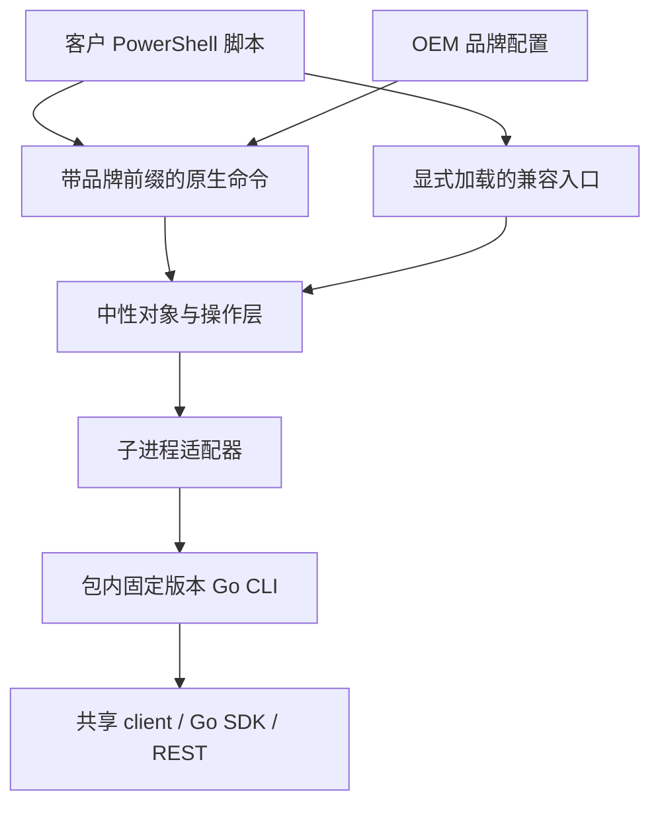

# System Architecture: PowerShell / OEM / PowerCLI migration

**Date:** 2026-11-09  **Track:** BMad Method  **Status:** Planning baseline
**Source PRD:** [prd.md](prd.md)。本文件记录规划契约。当前实现与验收证据见 [预览验收](../powershell/release/acceptance-checklist.md)。

## System Overview

首版交付连接、查询、启动、等待、OEM 包和有限迁移入口。Architecture drivers：NFR-001 凭据、NFR-002 写安全、NFR-004 OEM 共用、NFR-006 迁移证据。遵循 [project-context.md](project-context.md)。

## Architecture Pattern

Layered adapter：公共 PowerShell advanced functions → 中性业务/对象层 → CLI process adapter → 内置 Go CLI → 共享 client / SDK / REST。没有新服务、新数据库、FFI 或远端网关。Justification：共享现有 CLI 的认证、锁、解析、分页和错误契约，集中补缺口。

## Architecture Decision Records

### ADR-001: API style — CLI-first process contract

**Status:** Accepted for planning. **Context:** FR-003，NFR-004；当前 SDK 是 Go v0.0.10，不是 .NET assembly。
**Decision:** 复用包内固定 CLI，以 argv 数组调用，不经 shell、Invoke-Expression 或拼接命令字符串。stdout/stderr 并发读取，UTF-8 明确编码；单次stdout上限128MiB、stderr上限8MiB，超限终止本地读取并报协议错误，写结果按未知处理。业务命令必须有独立 JSON 契约；登录输出只在适配器内部消费，不原样转发。退出码与 JSON 必须同时检查。底层 REST / SDK 的选择仍归 CLI。
**Consequences:** 共用后端逻辑；成本为进程启动、序列化及 CLI 契约维护。禁止从混合文本截取 JSON。缺口在 CLI/shared client 补齐，不偷偷直接发 REST。
**Alternatives:** PowerShell 直连 REST 会复制认证与错误模型；Go SDK 无法直接 Import-Module；Go FFI/常驻桥接增加 ABI、生命周期与分发成本。未验证可用 .NET SDK，不假定存在。
**Revisit when:** 固定基准持续超过 NFR-003 目标且批量查询/减少进程调用不能解决；或明确需要 CLI 无法表达的流式/异步契约。先 ADR 评审，再考虑复用共享 Go 层的窄桥接接口，不能在每个命令分别直连 SDK。

### ADR-002: Data model — stable PowerShell projection

**Status:** Accepted for planning. **Context:** FR-004，NFR-006。
**Decision:** 使用 PSCustomObject + 中性 PSTypeNames（Cloud.Automation.VM/Connection）。不伪装 VMware .NET 类型。属性白名单与单位固定；保留 RawState，未知状态 PowerState=Unknown。数据由实例查询 JSON 投影，不依赖 table。
**Consequences:** 报表可复用，深层 ExtensionData 必须改写；缺失字段为 null 或契约错误，绝不伪造成功。
**Alternatives:** 原样透出 JSON 属性会增加客户改造；克隆 VMware 对象图范围失控。

### ADR-003: AuthN/AuthZ — protected stdin and isolated sessions

**Status:** Accepted for planning. **Context:** FR-002，NFR-001。
**Decision:** 为 CLI 新增计划中的 login --password-stdin。UTF-8 原始密码读取至 EOF，限制 64KiB，拒绝空值/与 --password/AK-SK 混用，不剥离任意空白；调用方不额外写换行。当前终端登录保持原状。PowerShell 从 PSCredential 仅在写私有 stdin 时暂时解密，结束关闭管道并释放可释放缓冲；不承诺消除托管内存所有副本。CLI 仍用共享 LoginAccountContext，模块强制 --save-password=false --no-switch。
**Consequences:** 需要先做 CLI 回归。密码不经 argv/环境/文件。会话文件仍敏感：每连接独立私有目录、Windows 当前用户 ACL、Unix 0700/0600；不把 session ID 返回公共对象。不绕过服务端授权。父进程环境不变，子进程清除继承 ZSTACK_* 再设置专用 ZSTACK_CONFIG。网络协议沿用 CLI 支持的端点，不能凭包装层宣称已有 TLS 能力；部署网络保护由既有云端连接政策决定。
**Alternatives:** --password 参数可被进程列表暴露；自动写用户默认配置会串环境；模块另做 HTTP login 会复制认证。

### ADR-004: State management — explicit immutable connection routing

**Status:** Accepted for planning. **Context:** FR-002/005，NFR-002。
**Decision:** 内部 registry 用 BrandId+ConnectionId 定位 endpoint、config path、context、generation、package version。公共连接对象只带身份快照；可见属性本身不能当作防篡改机制。registry保存对象引用与原始资源/连接身份，写前校验一致性并在原连接核对UUID；PSTypeNames不作为认证证明。VM 操作从 registry 反查；不用对象可修改路径或 endpoint。唯一活动连接可省略 -Server，多个连接必须显式指定；与 PowerCLI 默认多服务端扇出不同，列入差异清单。断开后 generation 失效，旧对象不能重连到新 endpoint。反序列化对象缺少本地登记时拒绝写。
**Consequences:** 不操作用户 CLI 默认 context，不改 VMware DefaultVIServer。Disconnect 先尝试远端 logout；无论远端失败均本地清理并将连接失效，同时报告撤销失败。崩溃残留仅按本模块登记的过期目录清理，不扫描删除陌生配置。
**Alternatives:** global context / env 易跨 OEM 串用；对象里携带可编辑凭据路径不可信。

### ADR-005: Error/response and mutation conventions

**Status:** Accepted for planning. **Context:** FR-003/005，NFR-002。
**Decision:** 绑定错误/缺 CLI/连接失效/协议错误为 terminating；批量单项远端失败用 WriteError，尊重 -ErrorAction Stop。稳定 FullyQualifiedErrorId 由错误码与操作形成，TargetObject 仅含安全资源身份。Success stream 仅投影对象，warnings 使用 Warning 流，进度单独处理；原始 stderr 不直接回显到 OEM UI。
**Consequences:** 超时/取消/输出损坏的写结果标记 OutcomeUnknown，包含资源 Id 和连接引用供查询，不自动重试、不承诺服务器回滚。WhatIf 可进行必要只读解析但不得发业务写；不调用旧 CLI dry-run 来替代 ShouldProcess。每目标确认一次，确认通过才调用 --yes。等待以实际状态为准，启动响应不伪装 VMware Task。
**Alternatives:** 只看 $LASTEXITCODE 或 catch 字符串会丢失协议与部分失败；把普通返回当作完成会误报。

### ADR-006: Naming / OEM / compatibility are independent

**Status:** Accepted for planning. **Context:** FR-006/007，NFR-004。
**Decision:** 核心使用中性内部类型和操作名；brand JSON 仅含 BrandId、DisplayName、ModuleName、CommandPrefix、ConfigNamespace、Publisher、HelpUri。自有品牌候选 ZStack.PowerCLI/ZStack；OEM 测试值 Acme.Cloud/Acme。真正中性商业名尚未定，不发布示意名。生成薄函数而非复制业务，模块名、目录和 manifest 大小写完全一致。运行时不执行品牌配置里的任意代码。
**Consequences:** 默认只导出 Get-<Prefix>VM 等。兼容包单独加载，导出已验证的 Connect-VIServer/Disconnect-VIServer/Get-VM/Start-VM 子集；导入前 Get-Command -All 检测冲突（含 VMware、Hyper-V 和用户函数），拒绝而不是强制覆盖，不改全局别名。用户用独立 pwsh 会话执行兼容脚本；兼容参数白名单：Connect的Server/Credential、Disconnect的Server、Get的Name/Id/Server、Start的VM/Server与各自CommonParameters；Start不自动继承原生Name/Id入口。同名入口不保证绑定 VMware 专属对象、动态脚本或模块限定命令。默认核心包可与 VMware 并存；兼容包移除后无全局残留。
**Alternatives:** 只改成 ZS 仍非中性；全局 alias 覆盖风险大；每 OEM 分叉维护成本高。

### ADR-007: Deployment — self-contained versioned package

**Status:** Accepted for planning. **Context:** FR-008/009，NFR-005。
**Decision:** 首版完整包内含 PowerShell 文件与 Windows amd64 CLI、版本/能力清单、校验值和许可证。模块按绝对路径选包内程序，支持版本是明确组合，不搜索 PATH。Import 无下载、无登录、无网络；在线安装使用模块仓库，离线解压到模块路径或显式 manifest 路径。PowerShell 本身是前提，不随包安装。
**Consequences:** 包体更大，但客户无需另装 CLI/Go/Python。开发测试使用 Pester 5.x，非运行时依赖。整包原子版本升级/回退；已有连接固定旧包，重新导入新版本要求断开旧连接或开新会话。包内哈希用于完整性，不当作可信签名；发布身份、签名与仓库权限在正式交付门槛确认。本轮无 Publish-Module 动作。
**Alternatives:** 首次 Import 下载不适合离线；独立 CLI 安装增加路径和版本漂移。

## Component Design

| Component / planned directory | Interface / responsibility | Data owned |
| --- | --- | --- |
| powershell/module | manifest、装载、公开函数注册 | 包版本与导出命令表 |
| powershell/private/process | Invoke-CliProcess：参数、环境、stdin、双流、取消 | 进程生命周期 |
| powershell/private/connections | Connect/Disconnect 与查找 ConnectionId | 私有 registry 和会话目录 |
| powershell/private/objects | CLI DTO → VM 对象 | 纯映射、无网络 |
| powershell/public | 参数绑定、查询、选择、ShouldProcess、等待 | 无凭据 |
| powershell/compatibility | PowerCLI 风格子集包装与冲突检测 | 独立模块导出 |
| powershell/branding | 品牌 schema 与包生成规则 | 品牌元数据 |
| powershell/tests | Pester、CLI stub、合成脚本 | 非敏感 fixtures |

## Data Model

### Entity: Connection

公共：Id（随机本地标识）、Server（规范 endpoint）、BrandId、IsConnected。内部：ConfigPath、ContextName、Generation、PackageVersion，不能从公共属性反向信任。没有数据库；持久会话由 CLI config 管理，权限按 ADR-003。

### Entity: VM

| 属性 | 类型 / 来源 |
| --- | --- |
| Id | string；CLI uuid，保持 ZStack UUID，不伪造 vm-123 |
| Name | string；name |
| NumCpu | nullable int；cpuNum |
| MemoryGB | nullable double；新增 memorySizeBytes / 1073741824，名称沿用 PowerCLI 风格，文档说明二进制换算 |
| PowerState | string；Running→PoweredOn、Stopped→PoweredOff，其他→Unknown |
| RawState | string；state 原值，不把 Paused/Destroyed 当作 PoweredOff |
| ConnectionId / BrandId / Generation | 本地查询注入；用于 registry 校验，不提供凭据 |

新增 CLI memorySizeBytes 为整数原始字节；保留现有 memorySize 字符串，避免破坏现有用户。不通过格式化值反算。不假设 VMHost、Guest、ExtensionData 已存在。

### Entity: mutation JSON / ErrorRecord

计划统一 start 的 -o json 为 {operation:"start", items:[{uuid,status,inventory,error}]}；status 取 succeeded/failed/skipped，error 使用稳定机器码，内容脱敏。退出 0 不含 failed；部分失败非零，仍输出有效 JSON。默认 text 行为保留。模块不把 skipped 当作新启动成功；对已运行目标返回当前 VM，对其他无效状态报冲突。公共错误保留 OutcomeUnknown 与目标 Id，禁止原样输出配置或服务端原始响应。

## API Specifications

以下为拟议模块契约，不是当前可用命令；<Prefix> 是生成参数而非未决实现。

| API | 参数/返回 | 边界 |
| --- | --- | --- |
| Connect-<Prefix>Server | -Server string -Credential PSCredential；Connection | 仅账户密码首版；不接受 vCenter URL 假装连接 |
| Disconnect-<Prefix>Server | -Server Connection[]；无成功对象 | 只清理所属连接；错误按 ADR-004 |
| Get-<Prefix>VM | -Name string[]（位置0，可通配符）或 -Id string[]；-Server Connection；VM 流 | Name/Id 互斥；默认全量自动分页；匹配采用 PowerShell WildcardPattern IgnoreCase，不把通配符直接塞入 CLI 精确名称 |
| Start-<Prefix>VM | -VM VM[]（位置0/管道）或 -Name string[] / -Id string[]；-Server；VM 流 | 同名兼容包可接受 -VM string[] 再显式解析；逐 UUID，CLI 传 `--uuid-only`，默认串行；无 RunAsync/Kill |
| Wait-<Prefix>VM | -VM VM[] -State Running -TimeoutSeconds（默认300，1–3600） -PollSeconds（默认2，1–60） | 使用 CLI wait instance；返回Observation后按UUID重新查询get instances并投影；非 VMware Wait-Task；等待并非启动 |

Get -Name 空数组/空字符串拒绝；省略 Name/Id 才是列出全部。名称精确/通配查询可返回多个；写操作名称须唯一，显式对象列表可批量。查询按 uuid 排序分页，完成拉取后本地筛选 Name，避免漏匹配；本首版不对 10000 台 VM 发 10000 个 describe。
Start 默认调用后等待 Running，成功才输出刷新 VM。超时默认300秒；模块总 deadline 包含进程与轮询；每次调用CLI wait传递剩余预算，预算耗尽不再启动进程，不能在启动后重新计300秒；CLI legacy SDK 取消不完全可控，取消子进程后状态仍需核对。RunAsync/VMware Task 无支持，绑定时拒绝。

## FR / NFR Coverage Matrix

| ID | Component | ADR | Status |
| --- | --- | --- | --- |
| FR-001 | 兼容矩阵、迁移基准 | 002/006 | Addressed in plan |
| FR-002 | connections、stdin | 003/004 | Addressed in plan |
| FR-003 | process、CLI 契约 | 001/005 | Addressed in plan |
| FR-004 | objects、query | 002/004 | Addressed in plan |
| FR-005 | ShouldProcess、start、wait | 004/005 | Addressed in plan |
| FR-006 | compatibility | 006 | Addressed; optional after native slice |
| FR-007 | branding、diagnostics | 006 | Addressed in plan |
| FR-008 | package builder、loader | 007 | Addressed in plan |
| FR-009 | docs、CI、release checklist | 007 | Addressed in plan |
| FR-010 | roadmap | 001/006 | Deferred; follow-up scope required |
| NFR-001 | process、connections | 003 | Security fixtures + ACL |
| NFR-002 | registry、errors、writes | 004/005 | Reliability / unknown outcome |
| NFR-003 | paged query、benchmark | 001/002 | Performance / scalability target |
| NFR-004 | branding builder | 006 | Maintainability via identical core |
| NFR-005 | package / CI | 007 | Explicit platform matrix |
| NFR-006 | migration corpus | 002/006 | Synthetic vs customer evidence |

## Technology Stack

**Rationale:** 保留现有Go实现以复用认证和资源行为；选择PowerShell原生函数以支持对象管道、参数绑定及确认惯例。

PowerShell 7.4 技术下限与受支持的选定 7.x，理由为原生参数与跨平台基础；Go 1.25、现有 SDK v0.0.10 留在 CLI；Cobra/Viper/配置锁继续复用；Pester 5.x 为开发依赖，具体版本在开发锁定。无 .NET SDK 假设、无新增数据库。Availability 取决于云端和本地 CLI，不新增服务 SLO。

## Trade-off Analysis

| 方案 | 复用程度 | 新增成本 | 决策 |
| --- | --- | --- | --- |
| 内置 CLI | 认证、context、锁、resolver、分页、错误和已有操作 | 进程/JSON、CLI 缺口、PowerShell 对象 | 首选 |
| PowerShell 直接 REST/.NET SDK | 若 SDK 存在可复用部分模型，当前仓库未证实 | 第二套认证/分页/重试/错误/版本适配 | 首版不选 |
| Go SDK + 进程桥接 | 可复用底层 Go 包 | 新协议、打包与服务/ABI 管理 | 性能或能力实证后再评估 |

CLI 复用显著减少“重复后端开发范围”，不能据此编造节省百分比。PowerShell 语法由引擎提供，模块仍需实现参数绑定、对象、命令风格和语义；OEM 与兼容测试也不会自动消失。后续若缺 API，优先在共享 CLI/client 增量扩展。

## Deployment Architecture

模块 manifest → private/public/functions + bin/windows-amd64/CLI + capability/version manifest + licenses。在线仓库或离线完整包，不在 Import 里下载。开发用 stub，CI 用本地模拟 API，客户环境只在另行授权后运行隔离资源验证。升级回退整包，活动连接固定版本。发布前决定真实 ModuleName、Publisher、签名与仓库；不能发布 Acme 等示意身份。

## Future Considerations

先查询，再启动/等待，再有限同名兼容。Stop-VM 为断电类行为而当前 CLI stop 写死 grace；Shutdown-VMGuest 更涉及 guest 能力。均须核实 SDK/服务端能力及真实环境语义，不自动映射。后续快照/创建/删除/RunAsync 需要独立 ADR/故事。其他 OS 与 5.1 根据客户需求扩展，不能靠构建成功认证。

## References

核对日期 2026-11-09。官方页面是外部事实依据，本文中的接口和目标是本项目设计。

- [PowerCLI 安装与模块形态](https://developer.broadcom.com/powercli/installation-guide)
- [Get-VM 参数参考](https://developer.broadcom.com/powercli/latest/vmware.vimautomation.core/commands/get-vm)
- [Stop-VM 行为](https://developer.broadcom.com/powercli/latest/vmware.vimautomation.core/commands/stop-vm)
- [PowerShell ShouldProcess](https://learn.microsoft.com/en-us/powershell/scripting/learn/deep-dives/everything-about-shouldprocess)
- [PowerShell 模块与安装/加载](https://learn.microsoft.com/en-us/powershell/module/microsoft.powershell.core/about/about_modules)
- [模块大小写与文件系统边界](https://learn.microsoft.com/en-us/powershell/module/microsoft.powershell.core/about/about_case-sensitivity)
- 本地事实：[login](../cmd/login.go)、[start](../cmd/resources/start_instance.go)、[stop](../cmd/resources/stop_instance.go)、[VM 查询](../cmd/get/instances.go)、[go.mod](../go.mod)。
